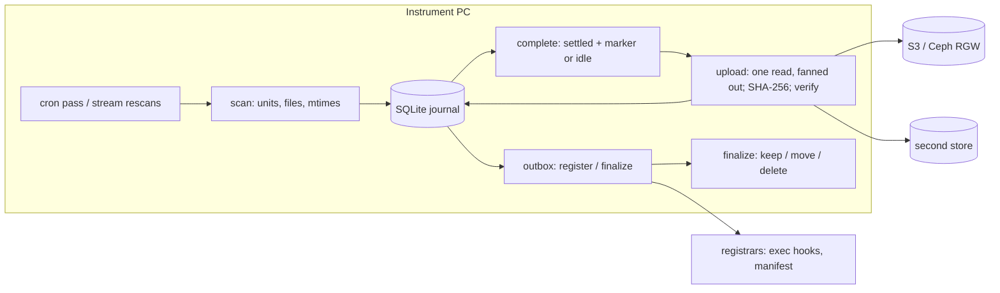

# ferry design

## The problem

Instruments write acquisitions to the disk of the PC they are attached to,
usually Windows, often with vendor software that holds files open for minutes
and writes whole folders over hours. The data has to reach object storage (AWS
S3, an on-premises Ceph cluster, or both), be recorded in a catalog that
downstream pipelines read, and then leave the instrument's disk -- moved to a
backup drive or deleted -- without ever losing the only copy.

Required: a nightly-batch (cron) or streaming trigger per folder; several
folders per PC, each with its own destinations; uploads that never send a
half-written file or register a half-written acquisition; deleting the source
only once every copy is verified; local logs; and a seam for registering data
(and logs) in a catalog.

## Existing tools

None covers the whole problem:

- **Arcadia Science Data Hub watcher** (MIT, beta): the closest whole system.
  It is a Windows-service watcher with stability checks and run grouping, but
  it uploads through presigned URLs from its own API to AWS, into its own
  catalog. It has no nightly mode and no backup-drive leg. Its stability period
  and run grouping are the model for ferry's `settle` and units.
- **rclone** (`move --min-age` on a timer): fast and Ceph-aware, with bandwidth
  timetables. It has no watch mode, one destination per invocation, and no hook
  for registering what it moved.
- **Apache MiNiFi C++**, **iRODS automated ingest**: capable dataflow and
  data-management systems, but heavy to operate on an instrument PC, and each
  brings its own catalog model.
- **MinIO `mc mirror --watch`**: the community edition was archived in
  February 2026.
- **Dagster** sensors poll from a central daemon that cannot see an
  instrument's local disk. Downstream orchestration stays where it is, reading
  what ferry registers.

## Why Rust, and one binary

An agent that runs unattended for months on lab PCs should be one file with no
runtime to install or break, small and steady in memory, and fast enough to
hash and upload at disk speed while the instrument keeps writing. ferry is a
single Rust binary built from well-trodden crates: `object_store` (the I/O
layer under obstore, Arrow and Delta) for S3 and local stores, `notify` for
file events, `croner` for cron arithmetic, `rusqlite` (bundled SQLite) for the
journal, `aws-lc-rs` for SHA-256, `tokio` for concurrency, and `windows-service`
for a native Windows service. The same binary is published as a Python wheel
(maturin `bindings = "bin"`) so `pip`/`uv` users install it without a Rust
toolchain.

## Architecture



One `Engine` per pipeline owns its steps, and two drivers run it.
`run_pass` does every step once (`mode: cron`, `ferry run`). The stream loop
(`mode: stream`) runs them continuously, with uploads and finalizations as
background tasks. Every step reads and writes the journal, and the journal is
the only state, so a driver can be killed between any two steps. All pipelines
share one journal and one process; each pipeline's loop is supervised and
restarted if it fails.

## Units, settling, completion

A **unit** is one acquisition: a directory at a fixed depth (`unit.dirs`, a
glob per level), or the files whose path gives the same `unit` group of a regex
(`unit.regex`, for instruments that write flat folders). A file's path within
its unit is kept in the store: `<prefix>/<unit>/<within>`.

A file has **settled** when its mtime is at least `settle` old: the same rule
as rclone's `--min-age`. A writer that preserves an old mtime (a copy tool,
say) is caught by the before/after stat around every upload. On Windows,
`probe_exclusive` also treats a file another process holds open (a sharing
violation on an exclusive open) as unsettled.

A unit is **complete** when every one of its files has settled and either its
`marker` is present or nothing in it has changed for `unit_idle`. "Changed"
means the newest mtime of anything in the unit: files that are not uploaded
count, and so do directories, whose mtime moves when entries are added, removed
or renamed. A completed unit gets a new `generation`. Any later change to it --
a new file, a rewritten one -- reopens it, so it completes, uploads and
registers again with a higher generation, never with a partial file list.

**A scan only counts what it could read.** Anything it cannot -- a directory it
may not list, an entry it cannot stat, a name that is not valid Unicode, a
symbolic link -- is recorded against the unit it is in (`scan_error`). Such a
unit keeps the files it had, counts none as gone, and does not complete,
register or finalize until a scan reads it in full; an alert says why. Errors
outside any unit (the root itself, a level above the units) mean no unit counts
as gone that round, since one may be there unseen. With `unit.regex` any error
could hide any unit's files, so every unit waits. A share that drops therefore
looks like nothing at all, not like everything deleted.

**Paths.** Names are used as the file system returns them, with no Unicode
normalization; one that is not valid UTF-8 is a scan error. Symbolic links (and
Windows junctions) are never followed: a link's target may be anywhere, and
ferry ships only what is under the root. A key is `<prefix>/<unit>/<within>`,
joined with `/` from the path's components; each name is percent-encoded where
a key cannot hold it faithfully (`%`, `\`, control characters), so distinct
names keep distinct keys and decode back exactly. ferry does not fold case:
two names differing only in case are two keys, as they are on Linux and in S3.
Where they would collide -- two destinations, or log shipping, under one prefix
of one bucket at one endpoint, or of one directory -- the config is rejected,
as is anything ferry writes locally (state, logs, a local store, a backup root)
inside a watched root.

## The journal

```text
unit:   open -> complete -> registering -> registered -> finalized
           ^------ any change reopens ---------------------------'
        abandoned (operator), gone (vanished before any upload)
file:   pending -> uploaded -> finalized        pending -> gone
copy:   one row per (file, destination): pending | done, with the size and
        mtime of the bytes that were sent
outbox: (unit, generation, registrar, event) rows, delivered in order
```

- A **copy** is *current* only while its recorded size and mtime equal the
  file's: one SQL predicate decides it everywhere. A file is `uploaded` once
  every destination holds a current copy, so a file that changes is pending
  again for every destination without any other bookkeeping. A destination
  added to the config gets copy rows for everything not yet finalized.
- A unit moves from `complete` to `registering` when every *required*
  destination holds a current copy of every file. The manifest and the
  matching transfer events are frozen into the outbox payload in the same
  transaction, as a compare-and-set on the unit's state and generation.
- `registering` becomes `registered` when every *required* registrar has
  confirmed the current generation. Optional registrars are retried but never
  waited on.
- Finalizing waits for *every* destination (optional ones too), the
  `finalize.after` grace period after the last copy, and a fresh stat of each
  source file. It is a compare-and-set from `registered` at the same
  generation, so a finalize that moved files while a scan reopened the unit
  cannot overwrite the reopen.

Recovery after a crash at each point:

- Mid-upload: the copy is still pending and goes again (the next PUT or
  multipart upload overwrites whatever was left).
- After delivering to a registrar, before recording it: delivered again.
  Registrars are idempotent upserts, which is the contract.
- Mid-finalize: a file is set aside by a rename before it is moved or
  deleted, and the next attempt carries on from the file set aside. Across
  file systems the backup is written under a temporary name and hashed on the
  way; it must match what was uploaded before the source goes. A file missing
  at finalize counts as moved only if its backup hashes like the upload;
  otherwise the unit waits, and alerts.
- After a lost journal: everything is uploaded again unless `adopt` is set.
  `adopt: sha256` lists each unit's prefix before its first upload and counts
  an object only if it reads back with the local file's SHA-256. `adopt: size`
  counts any object of the right key and size -- some other file of that size
  would pass -- so it is refused unless source files are kept.
- A destination's identity (bucket, endpoint and full prefix, or directory)
  and `verify` are recorded. Copies made at one place are no evidence of
  another, so a changed identity stops ferry until an operator runs `ferry
  destination accept` or `reset`. A stronger `verify` sends again what the
  weaker check covered. Undelivered events for a registrar no longer in the
  config also stop it, until `ferry outbox discard`: removing a required
  registrar must not quietly let units finalize.

## Transfers and fan-out

Files up to `single_put_max` (64 MiB) go up in one PUT. Microscopes write
thousands of small TIFFs, and a multipart upload costs three or four requests
per file. Bigger files stream as multipart parts, read on a blocking thread
that hashes them (SHA-256) as it goes. Each store's token bucket (`bandwidth`,
optionally per time window) paces its requests.

**One read, many destinations.** The reader produces `Bytes` chunks, which are
reference-counted: handing a chunk to a second destination's single PUT or
`WriteMultipart` copies nothing. So N destinations cost one disk read and one
hash, not N. This is what an
[obstore discussion](https://github.com/developmentseed/obstore/discussions/529)
asked for -- one read stream feeding several stores -- where the answer was to
manage it in the caller; in Rust it is a few lines. Two consequences shape the
design:

- The slowest destination paces the others (a chunk is released once every
  destination has taken it; `wait_for_capacity` bounds what is buffered).
  `fanout: separate` trades extra reads for independence.
- A destination that fails mid-file is aborted and drops out; the others carry
  on. Its copy row records the failure and backs off, and the retry reads the
  file again for that destination alone.

After every upload a HEAD checks the stored size; `verify: sha256` also reads
the object back and compares hashes. `object_store` signs every payload
(SigV4), so the server rejects corruption in transit, and `checksum: sha256`
adds a server-verified whole-object checksum where the server supports it.

## Deleting the source

`finalize.action: delete` is the one irreversible step, so it waits for the
strongest evidence ferry has: every destination (not just the required ones)
holds a copy that verified at the file's current size and mtime, every
required registrar has confirmed the unit, and `finalize.after` has passed
since the last copy (time for downstream checks or replication). Then, for a
move or a delete:

1. **Recheck the copies.** A HEAD of every copy: it must still be there with
   the size sent and the ETag recorded at verification. One deleted (a
   lifecycle rule, a person) or overwritten during the grace period is sent
   again, and the unit registers again, before anything local is touched.
2. **Set the file aside** by renaming it to `name.ferry-finalizing` in its
   directory -- atomic, and invisible to scans. A writer that comes back to
   the name now creates a new file, which is picked up as one.
3. **Check what was set aside**: the size and mtime that were uploaded and,
   before a delete, the SHA-256, since a rewrite can keep both. Anything else
   is put back (under a new name if a new file took the old one) and sent
   again.
4. **Act and record.** Delete it, or move it to the backup root (renamed, or
   copied and hashed across file systems). The journal row is updated only if
   it still describes those bytes -- a compare-and-set on its size and mtime --
   so a scan that saw new bytes meanwhile is never overwritten.

`action: move` follows the same gate and keeps the file on a backup drive.
What it cannot rule out: a process that already holds the file open on Linux
or macOS can write through the rename. On Windows, the rename fails while a
writer holds the file, and finalizing waits.

## Registration: exec hooks

A registrar is a command, not a plugin API: ferry writes one JSON event to its
stdin and reads the exit code (see [hooks.md](hooks.md)). Of the generic
options for an OSS agent, this one needs nothing from the catalog side -- no
server to stand up as an HTTP hook would, no language binding as an in-process
plugin would -- and works with any language, an existing CLI, or a two-line
script, while ferry keeps the durability: the outbox retries with backoff,
delivers in order per unit, supersedes events of a reopened unit, and gates
finalizing on required registrars. An HTTP endpoint is one `curl` away for
those who want it. The built-in `manifest` registrar covers the catalog-less
case by writing the manifest next to the data.

Within one round ferry stops calling a registrar after its first failure, so a
catalog that is down costs one timeout rather than one per waiting unit. An
alert goes out after `retry.alert_after` attempts.

People get one receipt per unit rather than a stream of log lines: once every
destination holds it and its source files are dealt with, or only the
`finalize.after` grace is left. Receipts go through the same outbox, keyed by
notifier name, so a chat service that is down delays them without losing any;
the journal records which generation of each unit was announced, so a restart
or an upgrade never repeats one. Downstream processing should start from
registration instead, which comes first and is meant for machines.

## Scheduling and streaming

Cron expressions are evaluated by `croner` in an IANA zone, or as local
wall-clock time. Waits are taken in naps of at most 30 s that re-read the
clock, so DST changes, NTP steps and sleep are noticed. A time that DST skips
fires at the jump, a time it repeats fires once, and passes missed while the
PC slept collapse into one pass on wake.

A stream rescans every unit not yet finalized, plus any new unit directory (a
cheap listing), every `poll_interval`, and the whole tree every
`full_scan_interval`. File events only make a rescan happen sooner: they can be
dropped, and network shares deliver none. Between rescans the loop sleeps until
the earliest settle, idle, backoff or grace deadline (`next_due`), so a file is
picked up when it settles rather than at the next poll. Uploads are tasks
bounded by `files_in_flight` (oldest first); on stop, in-flight work gets a
grace period and is then cut off, to be retried by the next run.

## Operations

Logs are JSON lines, one file per UTC day, so a finished day is a finished
file. Shipping copies finished days to a store and runs the log registrars,
and a heartbeat object records each pipeline's summary: a push, for nodes
nothing can reach. For those something can, `ferry watch` serves the same
numbers as Prometheus metrics, read from the journal on each scrape, so they
agree with `ferry status`; transfer counters total the journal's transfers,
which are never deleted, and each scrape reads only those since the last.

On Windows, `ferry service install` registers a native service with the
service manager: delayed automatic start, restart actions on any failure (crash
or error exit), stop and shutdown handled as a graceful stop. On Linux it
installs a systemd unit, on macOS a launchd job. A service reads its secrets
from an `--env-file` before its config loads, so neither the config nor the
machine's environment holds them.

`ferry doctor` reads what `ferry run` would refuse to start over -- a
destination that moved, events for a registrar that is gone -- without
changing the journal, and reaches every store and hook the config names.

## Not (yet) here

Registration driven by bucket notifications on the manifest object; STS /
web-identity credentials; an OpenLineage registrar; self-update; fleet-wide
configuration.
