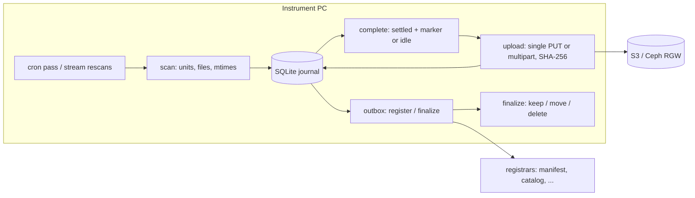

# ferry design

## The problem

Instruments write acquisitions to the disk of the PC they are attached to,
usually Windows, often with vendor software that holds files open for minutes
and writes whole folders over hours. The data has to reach object storage (AWS
S3, or an on-premises Ceph cluster), be recorded in a catalog that downstream
pipelines read, and then leave the instrument's disk -- moved to a backup drive
or deleted -- without ever losing the only copy.

Required: a nightly-batch or streaming trigger per source; uploads that never
send a half-written file or register a half-written acquisition; local logs;
and a seam for registering data (and logs) in a catalog.

## Existing tools

None covers the whole problem:

- **Arcadia Science Data Hub watcher** (MIT, beta): the closest whole system.
  It is a Windows-service watcher with stability checks and run grouping, but
  it uploads through presigned URLs from its own API to AWS, into its own
  catalog. It has no nightly mode and no backup-drive leg. Its stability period
  and run grouping are the model for ferry's `settle` and units.
- **rclone** (`move --min-age` on a timer): fast and Ceph-aware, with bandwidth
  timetables. It has no watch mode and no hook for registering what it moved.
- **Apache MiNiFi C++**, **iRODS automated ingest**: capable dataflow and
  data-management systems, but heavy to operate on an instrument PC, and each
  brings its own catalog model.
- **MinIO `mc mirror --watch`**: the community edition was archived in
  February 2026.
- **Dagster** sensors poll from a central daemon that cannot see an
  instrument's local disk. Downstream orchestration stays where it is, reading
  what ferry registers.

ferry is small on purpose: obstore (Rust's `object_store`) does the I/O,
`watchfiles` (Rust's `notify`) the file events, `cronsim` the cron
arithmetic, and SQLite the durable state.

## Architecture



One engine (`engine.py`) owns a source's steps, and two drivers run it.
`run_pass` does all the steps once (`mode: cron`, `ferry run`). `StreamLoop`
(`mode: stream`) runs them continuously, with upload and finalize workers in
the background. Every step reads and writes the journal, and the journal is
the only state, so a driver can be killed between any two steps.

## Units, settling, completion

A **unit** is one acquisition: a directory at a fixed depth (`unit.dirs`, a
glob per level), or the files whose path gives the same `unit` group of a regex
(`unit.regex`, for instruments that write flat folders). A file's path within
its unit is kept in the store: `<prefix>/<unit>/<within>`.

A file has **settled** when its mtime is at least `settle` old: the same
rule as rclone's `--min-age`. A writer that preserves an old mtime (a copy tool,
say) is caught by the before/after stat around every upload. On Windows,
`probe_exclusive` also treats a file another process holds open as unsettled.

A unit is **complete** when every one of its files has settled and either
its `marker` is present or nothing in it has changed for `unit_idle`.
"Changed" means the newest mtime of anything in the unit: files that are not
uploaded count, and so do directories, whose mtime moves when entries are
added, removed or renamed. A completed unit gets a new `generation`. Any later
change to it -- a new file, a rewritten one -- reopens it, so it completes,
uploads and registers again with a higher generation, never with a partial
file list.

## The journal

```text
unit:   open -> complete -> registering -> registered -> finalized
           ^------ any change reopens ---------------------------'
        abandoned (operator), gone (vanished before any upload)
file:   pending -> uploaded -> finalized        pending -> gone
outbox: (unit, generation, registrar, event) rows, delivered in order
```

- A file is `uploaded` only if its recorded stats still match the bytes that
  were sent. `mark_uploaded` compares them, so a scan that saw the file move on
  mid-upload keeps it pending.
- A unit moves from `complete` to `registering` only when no file is pending.
  The manifest and the matching transfer events are frozen into the outbox
  payload in the same transaction.
- `registering` becomes `registered` when every *required* registrar has
  confirmed the current generation. Optional registrars are retried but never
  waited on.
- Finalizing is a compare-and-set from `registered` at the same generation, so
  a finalize that moved files while a scan reopened the unit cannot overwrite
  the reopen.

Recovery after a crash at each point:

- Mid-upload: the file is still pending and goes again.
- After delivering to a registrar, before recording it: delivered again.
  Registrars are idempotent upserts, which is the contract.
- Mid-move: the copy is written under a temporary name and size-checked before
  the rename and the source delete. A file missing at finalize whose backup
  copy exists and has the right size is recorded as moved.
- After a lost journal: adoption lists each unit's prefix in the store before
  its first upload and skips files already there with the same size.

## Transfers

Files up to `single_put_max` (64 MiB) go up in one PUT. Microscopes write
thousands of small TIFFs, and a multipart upload costs three or four requests
per file. Bigger files stream as multipart parts, read on a worker thread that
hashes them (SHA-256) and draws from the source's token bucket (`bandwidth`,
optionally per time window). After every upload a HEAD checks the stored size.
obstore signs every payload (SigV4), so the server rejects corruption in
transit. `checksum: sha256` adds a server-verified whole-object checksum where
the server supports it.

## Registration

Registrars are called through the outbox: one row per registrar, event and
generation, delivered in id order. A finalize row waits behind an undelivered
register row for the same unit and registrar, so no registrar sees a unit
finalized before it has seen it registered. A registrar that fails is retried
with exponential backoff. Within one round, ferry stops calling a registrar
after its first failure, so a catalog that is down costs one timeout rather than
one per waiting unit. An alert goes out after `retry.alert_after` attempts.

Registrars receive a `Manifest`: the unit URI, every file's URI, size,
SHA-256, mtime, local and backup paths, adapter metadata, and the generation.
They also receive the unit's transfer events, for an audit trail. Failed
transfers and shipped logs have their own calls.

## Scheduling and streaming

Cron expressions are evaluated by `cronsim` in an IANA zone, or as local
wall-clock time. Waits are taken in naps of at most 30 s that re-read the
clock, so DST changes, NTP steps and sleep are noticed. A time that DST
skips fires at the jump, a time it repeats fires once, and passes missed while
the PC slept collapse into one pass on wake.

A stream rescans every unit not yet finalized, plus any new unit directory (a
cheap listing), every `poll_interval`, and the whole tree every
`full_scan_interval`. File events only make a rescan happen sooner: they can be
dropped, and network shares deliver none. Between rescans, the loop sleeps
until the earliest settle, idle or backoff deadline (`next_due`), so a file is
picked up when it settles rather than at the next poll.

## Operations

Logs are JSON lines, one file per local day, so a finished day is a finished
file. Shipping copies finished days to the store (and offers them to
registrars), and a heartbeat object records each source's summary. On Windows,
`ferry service install` registers a scheduled task that starts at boot as the
current user (S4U) and restarts on failure. That is what instrument PCs
already use, and it avoids hosting Python in a Windows service. On Linux it
installs a systemd unit.

## Not (yet) here

Prometheus metrics; registration driven by bucket notifications on the
manifest object; STS / web-identity credentials; an OpenLineage registrar;
self-update; fleet-wide configuration.
